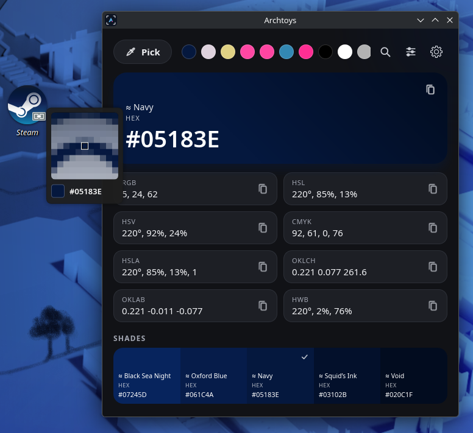
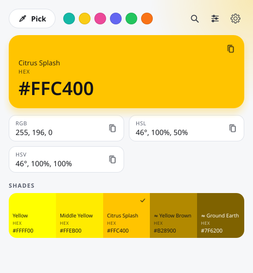
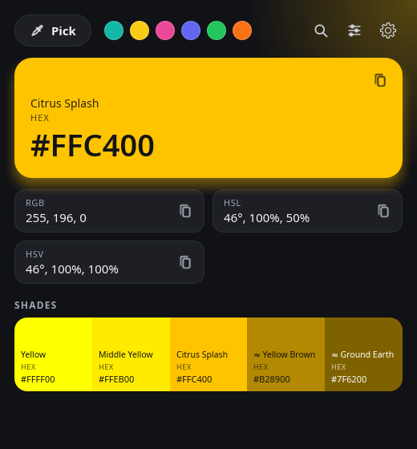
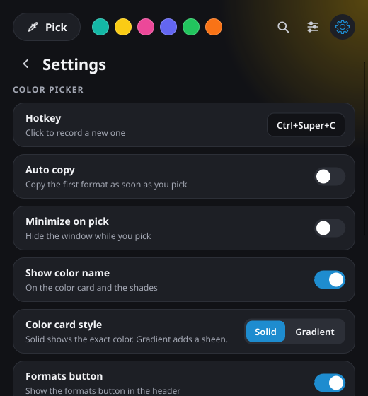
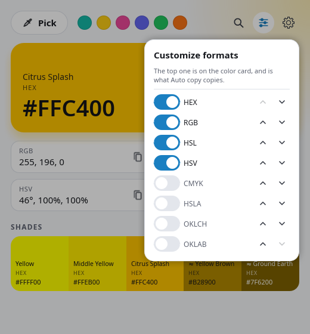
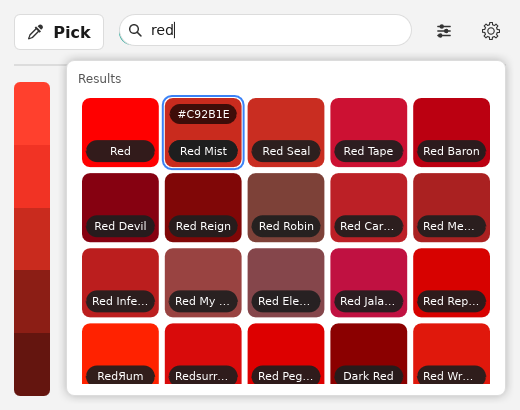

<div align="center">


# Archtoys

**A fast, system-wide color picker for Linux, inspired by Microsoft PowerToys.**

Pick any pixel, see it magnified and named, find colors by name, and copy them in the format you need.<br>
Wayland and X11 · at home on KDE Plasma · works offline

[](https://github.com/Mujtaba1i/Archtoys/releases/latest)
[](https://aur.archlinux.org/packages/archtoys)
[](https://aur.archlinux.org/packages/archtoys-bin)
[](https://copr.fedorainfracloud.org/coprs/mujtaba1i/archtoys/)
[](https://github.com/Mujtaba1i/Archtoys/releases/latest)
[](https://github.com/Mujtaba1i/Archtoys/releases/latest)
[](LICENSE)



</div>

## Highlights

|                                                                                                              |                                                                                                                          |
| ------------------------------------------------------------------------------------------------------------ | ------------------------------------------------------------------------------------------------------------------------ |
| **Pixel magnifier**<br>The pixels around your cursor, 10× larger, with the one you'll get outlined. | **Live preview, on Wayland too**<br>The color follows your mouse. On Wayland, Archtoys picks from one frozen screenshot. |
| **The color card** · new<br>Your first format, big, on the color itself. Click the value to type a new one. | **Color search**<br>Press `Ctrl+F` and type a name, a word like _sky_, or a code like `#FF46A2`. |
| **Your formats, your order**<br>HEX, RGB, HSL, HSV, CMYK, HSLA, OKLCH and OKLab. Type plain numbers like `255, 70, 162`; copying gives `rgb(255,70,162)`. | **Color names**<br>The CSS name when there is one ("Hot Pink"), otherwise the closest of ~32,000 ("≈ Barbie Pink"). |
| **Shades and history**<br>Five shades under the card, each with its value and name, and every color you pick is kept. | **Auto copy**<br>Copies the value on the card the moment you click, without opening the window. |
| **Global hotkey**<br>`Ctrl+Super+C` from anywhere. On Wayland it uses your desktop's own shortcuts. | **Light, dark or your desktop's theme** · new<br>A faint glow in the corner follows your color, and so does the dot on the tray icon. |

`Esc` or right-click cancels a pick and brings the previous color back. Archtoys lives in the tray and can start on login.

<div align="center">

|                                 Light                                 |                                Dark                                 |
| :-------------------------------------------------------------------: | :-----------------------------------------------------------------: |
|  |  |

<details>
<summary>Settings, and the Customize formats panel</summary>





</details>

</div>

## Install

| Distribution             | How                                                                                                                                                                  |
| ------------------------ | -------------------------------------------------------------------------------------------------------------------------------------------------------------------- |
| **Fedora**               | `sudo dnf copr enable mujtaba1i/archtoys && sudo dnf install archtoys`                                                                                               |
| **Arch** and derivatives | `paru -S archtoys-bin` (prebuilt) or `paru -S archtoys` (from source). `yay` works too.                                                                              |
| **Debian, Ubuntu, Mint** | Download `archtoys_<version>_amd64.deb` from [Releases](https://github.com/Mujtaba1i/Archtoys/releases/latest), then `sudo apt install ./archtoys_*_amd64.deb`       |
| **Any distribution**     | Download `Archtoys-<version>-x86_64.AppImage` from [Releases](https://github.com/Mujtaba1i/Archtoys/releases/latest), then `chmod +x Archtoys-*.AppImage` and run it |

<details>
<summary>More about each package</summary>

- **Fedora, without COPR:** download the `.rpm` for your Fedora version from [Releases](https://github.com/Mujtaba1i/Archtoys/releases/latest) and run `sudo dnf install ./fedora-*-archtoys-*.rpm`.
- **.deb:** apt installs the dependencies for you. It works on Ubuntu 22.04 and newer, and Debian 12 and newer. There are no automatic updates yet, so download the new file for each version.
- **AppImage:** runs on any distribution from Ubuntu 22.04 onwards, or anything equally recent.
</details>

## Usage

| To                                        | Do                                                                                     |
| ----------------------------------------- | -------------------------------------------------------------------------------------- |
| Pick a color                              | Click **Pick** or press `Ctrl+Super+C`, then left-click. `Esc` or right-click cancels. |
| Find a color by name                      | Press `Ctrl+F` or click 🔍 (see [Color search](#color-search))                         |
| Copy a value                              | Click the copy icon next to it. You get the full form, like `rgb(255,70,162)`.         |
| Enter a color by hand                     | Click the big value on the card, or a box, type, and press `Enter`. Plain numbers work. |
| Choose and reorder formats                | The sliders button, next to ⚙ (you can hide it; then it's in the ⚙ settings)           |
| Use a shade or an old color               | Click it in the shades or the history row                                              |
| Change the hotkey, theme, startup…        | The ⚙ settings                                                                         |
| Pick from a terminal or your own shortcut | `archtoys --pick` (starts Archtoys if it isn't running)                                |
| Report a problem                          | **Report a problem** in the ⚙ settings                                                 |

### Color search

Press `Ctrl+F` and type. Results appear as you type, as a grid of color cards, with how many colors matched and how long it took. The color card moves down under the results.

<div align="center">



</div>

| You type                                 | You get                                                                                                                |
| ---------------------------------------- | ---------------------------------------------------------------------------------------------------------------------- |
| `red`, `blue`, `gray`                    | Colors that really _are_ that color, even without the word in their name (Maroon for red). The exact name comes first. |
| `dark red`, `pale blue`                  | The same, only dark or light ones                                                                                      |
| `sky`, `blue sky`                        | Names with those words, in any order                                                                                   |
| `#FF46A2`, `rgb(255,70,162)`, `oklch(…)` | The nearest named colors                                                                                               |
| `pnik`                                   | A typo is fixed only when nothing matches, and the search says so: _Showing results for pink_                          |

Hovering a result shows it on the color card and shows its value in your first format. Click it (or use the arrow keys and `Enter`) to use it. `Esc`, `Ctrl+F` or a click on the color card goes back to your previous color.

## Desktop support

|                                        | KDE Plasma (Wayland) |               GNOME (Wayland)               | X11 (any desktop) |
| -------------------------------------- | :------------------: | :-----------------------------------------: | :---------------: |
| Picker with live preview and magnifier |   ✅ freeze frame    |               ✅ freeze frame               |      ✅ live      |
| Global hotkey                          |          ✅          | ✅ GNOME 48+ · ⚠️ older: `archtoys --pick`² |        ✅         |
| Tray icon                              |          ✅          |     ✅ with the AppIndicator extension¹     |        ✅         |

¹ Ubuntu enables it by default. On other GNOME setups, install _AppIndicator and KStatusNotifierItem Support_.<br>
² GNOME before 48 (including Ubuntu 22.04 and 24.04) can't register a global hotkey. Add your own in **Settings → Keyboard → Keyboard Shortcuts → Custom Shortcuts**, with the command `archtoys --pick`.

<details>
<summary>How picking works on Wayland</summary>

Wayland doesn't let apps watch the screen, which is good for your privacy. So when you start picking, Archtoys asks your desktop for **one screenshot** and shows it fullscreen while you choose. That's why moving content like videos pauses during a pick. The screenshot is deleted from disk as soon as it has been loaded, and nothing is ever saved.

</details>

## Troubleshooting

<details>
<summary><b>My desktop asks for permission the first time</b></summary>

That's expected on Wayland. Archtoys asks your desktop for permission to take a screenshot (for picking) and to register a shortcut (for the hotkey). Allow both once.

</details>

<details>
<summary><b>The hotkey doesn't work on Wayland</b></summary>

On Wayland, the hotkey belongs to your desktop's shortcut system (the GlobalShortcuts portal): the first time, your desktop asks you to confirm it. After that, Archtoys' settings show the shortcut your desktop actually uses, with a **Change in System Settings** button (on KDE: **System Settings → Keyboard → Shortcuts → Archtoys**). Older desktops without that portal use a fallback that only works while an X11 app has focus.

To force the fallback, start Archtoys with:

```bash
ARCHTOYS_HOTKEY_BACKEND=x11 archtoys
```

</details>

<details>
<summary><b>No magnifier on Wayland with several monitors</b></summary>

The freeze frame currently supports one monitor. With several, Archtoys falls back to your desktop's built-in color picker. It still picks the right color, but without the live preview. Multi-monitor support is on the roadmap.

</details>

<details>
<summary><b>Something else is wrong</b></summary>

Open the ⚙ settings and click **Report a problem**. It opens a new GitHub issue with your version, distro, desktop and the picker and hotkey methods already filled in, so you only describe what's broken. Archtoys sends nothing itself, and no file paths, user names or colors are included.

Running `archtoys` from a terminal also prints which picker and hotkey method it's using, and why it fell back if it did.

</details>

## Building from source

<details>
<summary>Archtoys is written in Rust with the <a href="https://slint.dev">Slint</a> UI toolkit. Show the steps.</summary>

**1. Install the build tools for your distribution.**

```bash
# Fedora
sudo dnf install rust cargo gcc pkgconf-pkg-config fontconfig-devel freetype-devel libX11-devel libxkbcommon-devel

# Arch
sudo pacman -S --needed rust pkgconf fontconfig libx11 libxkbcommon

# Debian / Ubuntu
sudo apt install cargo pkg-config libfontconfig1-dev libx11-dev libxkbcommon-dev
```

If your distribution's Rust is too old, install the latest with [rustup](https://rustup.rs).

**2. Clone, test and run.**

```bash
git clone https://github.com/Mujtaba1i/Archtoys.git
cd Archtoys
cargo test --locked
cargo run --release --locked
```

**Project layout**

```
src/
├── main.rs             startup and wiring
├── color.rs            color formats, parsing, shades (unit-tested)
├── formats.rs          which formats are shown, their order, Auto Copy
├── names.rs            color names (CSS names + data/colornames.csv)
├── search.rs           color search: families, typos, codes (unit-tested)
├── config.rs           settings (saved safely) and autostart
├── single_instance.rs  one copy at a time, archtoys --pick
├── diagnostics.rs      Report a problem
├── launch.rs           starting the browser and desktop settings
├── ui_state.rs         updating the main window
├── tray.rs             tray icon
├── portal.rs           talking to the desktop portal
├── hotkey/             global hotkey (portal and X11)
└── picker/             X11 live picker, Wayland freeze frame, fallbacks
ui/app.slint            the whole user interface
```

</details>

## Roadmap

Archtoys is growing into a **PowerToys-style toolkit for Linux**, with the color picker as its first tool.

- [x] Color search
- [x] A new look: the color card, shades with names, themes, and a new logo
- [ ] A color editor, and comparing two colors (contrast and how alike they look)
- [ ] **Text Extractor**: select any area of the screen and copy the text in it (OCR)
- [ ] A sidebar with multiple tools, in the style of PowerToys
- [ ] Freeze-frame picking across multiple monitors
- [ ] Ideas for later: **Awake** (keep your PC from sleeping) and **Screen Ruler** (measure things on screen)

Which PowerToys feature do you miss most on Linux? [Open an issue](https://github.com/Mujtaba1i/Archtoys/issues) and say so.

## Contributing

Bug reports, ideas and pull requests are all welcome. Please run `cargo test --locked` before opening a pull request, and write clear commit messages: they become the release notes.

## Acknowledgements and license

Inspired by the Color Picker in [Microsoft PowerToys](https://github.com/microsoft/PowerToys). Archtoys is an independent project and is not affiliated with or endorsed by Microsoft. Color names come from [meodai/color-names](https://github.com/meodai/color-names) by David Aerne, used under the MIT License (see [`data/colornames-LICENSE.txt`](data/colornames-LICENSE.txt)).

[MIT](LICENSE) © 2026 Mujtaba1i
