<div align="center">


# Archtoys

**PowerToys-style tools for Linux, inspired by Microsoft PowerToys.**

**Color Picker** · **Text Extractor** · **Screen Ruler**<br>
Wayland and X11 · at home on KDE Plasma · works offline

[](https://github.com/Mujtaba1i/Archtoys/releases/latest)
[](https://aur.archlinux.org/packages/archtoys)
[](https://aur.archlinux.org/packages/archtoys-bin)
[](https://copr.fedorainfracloud.org/coprs/mujtaba1i/archtoys/)
[](https://github.com/Mujtaba1i/Archtoys/releases/latest)
[](https://github.com/Mujtaba1i/Archtoys/releases/latest)
[](LICENSE)

[](https://mujtaba1i.github.io/Archtoys/support/)

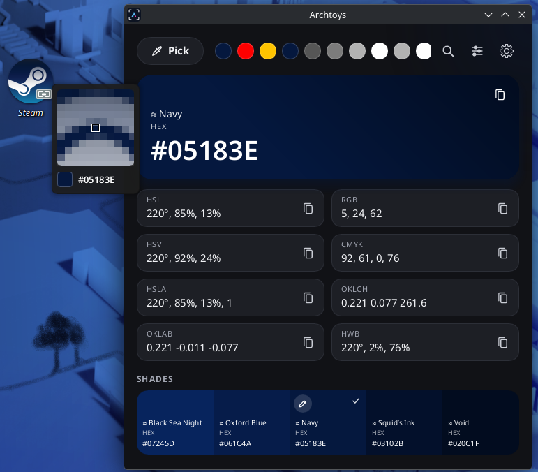

</div>

## The toys

Each toy has its own hotkey and works from anywhere. Move between them with the sidebar: click ☰ to keep it open, or rest the mouse on it. Archtoys lives in the tray and can start on login.

| Toy | What it does | Hotkey |
| --- | --- | --- |
| [**Color Picker**](#color-picker) | Pick any pixel, see it magnified and named, find colors by name, copy them in the format you need | `Ctrl+Super+C` |
| [**Text Extractor**](#text-extractor) | Drag over any text on screen and copy it, even from images, videos and apps that don't let you select text. [Find font](#font-finder) tells which font it's in | `Ctrl+Super+T` |
| [**Screen Ruler**](#screen-ruler) | Measure anything on screen: a box, the space around a point, a width or a height | `Ctrl+Super+M` |

<div align="center">

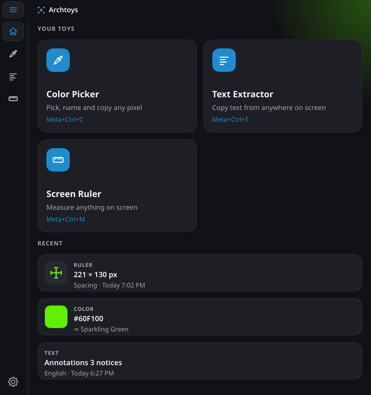

</div>

## Color Picker

| | |
| --- | --- |
| **Pixel magnifier**<br>The pixels around your cursor, 10× larger, with the one you'll get outlined. | **Live preview, on Wayland too**<br>The color follows your mouse. On Wayland, Archtoys picks from one frozen screenshot. |
| **The color card**<br>Your first format, big, on the color itself. Click the value to type a new one. | **Color search**<br>Press `Ctrl+F` and type a name, a word like _sky_, or a code like `#FF46A2`. |
| **Your formats, your order**<br>HEX, RGB, HSL, HSV, CMYK, HSLA, OKLCH, OKLab and HWB. Type plain numbers like `255, 70, 162`, and copying gives `rgb(255,70,162)`. | **Color names**<br>The CSS name when there is one ("Hot Pink"), otherwise the closest of ~32,000 ("≈ Barbie Pink"). |
| **Shades and history**<br>Five shades under the card, each with its value and name, and every color you pick is kept. | **Auto copy**<br>Copies the value on the card the moment you click, without opening the window. |
| **Color editor**<br>The pen on the middle shade opens it: drag saturation, brightness and hue, or type in your formats. Nothing changes until you press Use. | **Compare two colors**<br>Put a picked or typed color next to yours and see their contrast ratio (21 : 1 is black on white). |
| **Pixel-precise picking**<br>The arrow keys move the pick one pixel, `Enter` picks. The value next to the cursor is in your first format. | **Every monitor**<br>Pick on any of your monitors, right up to their edges, also with different scaling per monitor. |
| **Light, dark or your desktop's theme**<br>A faint glow in the corner follows your color, and so does the dot on the tray icon. | |

<div align="center">

|                                 Light                                 |                                Dark                                 |
| :-------------------------------------------------------------------: | :-----------------------------------------------------------------: |
| 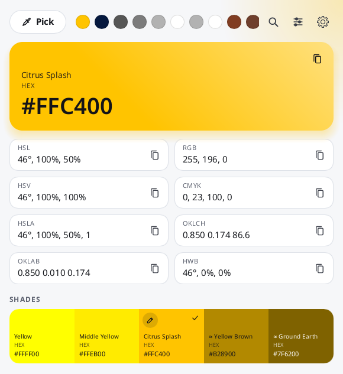 | 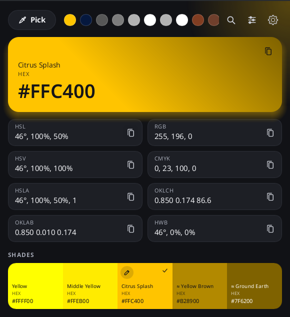 |

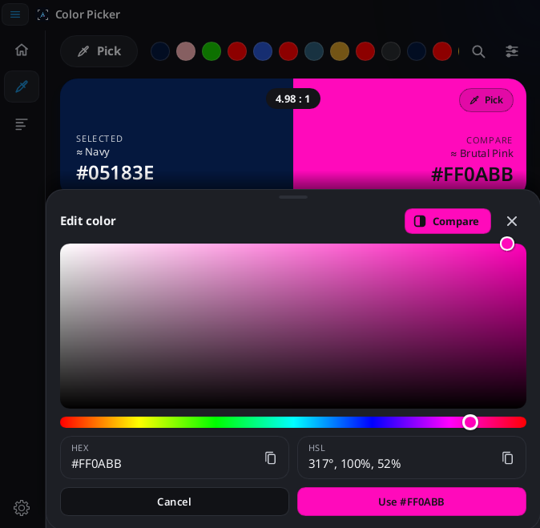

<details>
<summary>Settings, and the Customize formats panel</summary>

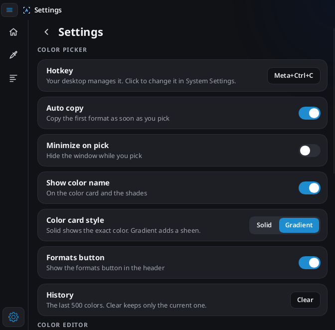

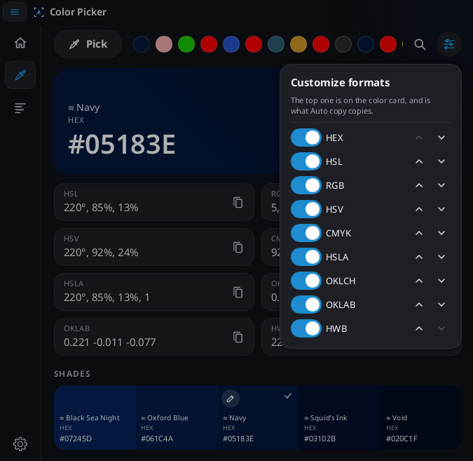

</details>

</div>

| To                           | Do                                                                                                                                                                    |
| ---------------------------- | --------------------------------------------------------------------------------------------------------------------------------------------------------------------- |
| Pick a color                 | Click **Pick** or press `Ctrl+Super+C`, then left-click (or move with the arrow keys and press `Enter`). `Esc` or right-click cancels and brings the previous color back. |
| Find a color by name         | Press `Ctrl+F` or click 🔍 (see [Color search](#color-search))                                                                                                        |
| Copy a value                 | Click the copy icon next to it. You get the full form, like `rgb(255,70,162)`.                                                                                        |
| Enter a color by hand        | Click the big value on the card, or a box, type, and press `Enter`. Plain numbers work.                                                                               |
| Choose and reorder formats   | The sliders button in the picker's top row (you can hide it in Settings, then it's there)                                                                              |
| Use a shade or an old color  | Click it in the shades or the history row                                                                                                                             |
| Edit a color, or compare two | Click the pen on the middle shade. **Compare** splits the card, **Pick** (or your hotkey) picks the second color, **Use** applies. `Esc` closes and keeps your edit.  |
| Pick from a terminal         | `archtoys --pick` (starts Archtoys if it isn't running)                                                                                                               |

### Color search

Press `Ctrl+F` and type. Results appear as you type, as a grid of color cards, with how many colors matched and how long it took. The color card moves down under the results.

<div align="center">

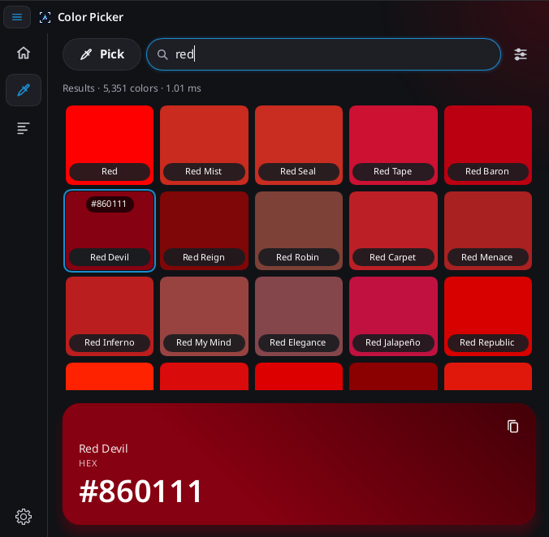

</div>

| You type                                 | You get                                                                                                                |
| ---------------------------------------- | ---------------------------------------------------------------------------------------------------------------------- |
| `red`, `blue`, `gray`                    | Colors that really _are_ that color, even without the word in their name (Maroon for red). The exact name comes first. |
| `dark red`, `pale blue`                  | The same, only dark or light ones                                                                                      |
| `sky`, `blue sky`                        | Names with those words, in any order                                                                                   |
| `#FF46A2`, `rgb(255,70,162)`, `oklch(…)` | The nearest named colors                                                                                               |
| `pnik`                                   | A typo is fixed only when nothing matches, and the search says so: _Showing results for pink_                          |

Hovering a result shows it on the color card and shows its value in your first format. Click it (or use the arrow keys and `Enter`) to use it. `Esc`, `Ctrl+F` or a click on the color card goes back to your previous color.

## Text Extractor

Copy the text in any part of the screen: a picture, a video, a PDF, an app that won't let you select its text. Press `Ctrl+Super+T` (or **Extract text**), drag over the text, and copy it. You only pick the area: Archtoys finds the language itself.

It is off until you want it: press **Turn on** and Archtoys installs the free [Tesseract](https://github.com/tesseract-ocr/tesseract) engine from your distribution's own packages (Arch, Fedora, Debian, Ubuntu and their families), with your password. It asks for the password even when Tesseract is already there, so the version is one Archtoys works with. On read-only systems (Fedora Silverblue, SteamOS), install `tesseract` the way your system installs software, then press **Check again**.

<div align="center">

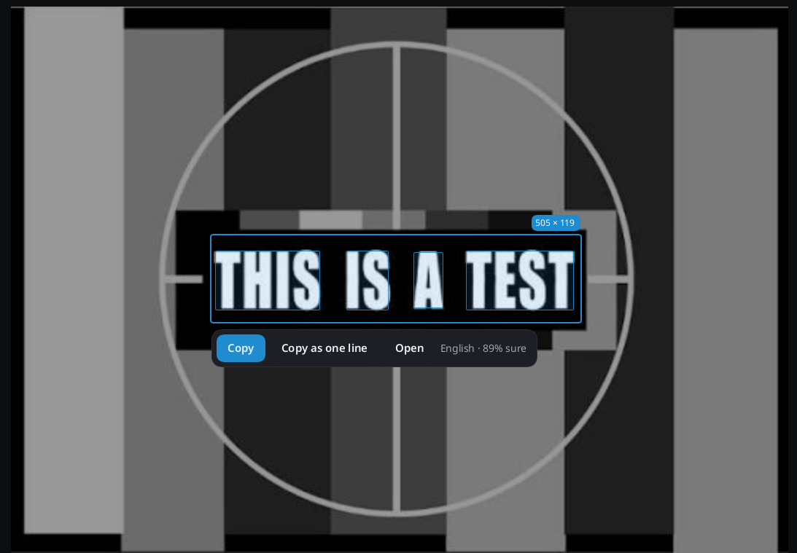

|                                                     Text Extractor                                                      |                                                Opened from the history                                                 |
| :----------------------------------------------------------------------------------------------------------------------: | :--------------------------------------------------------------------------------------------------------------------: |
| 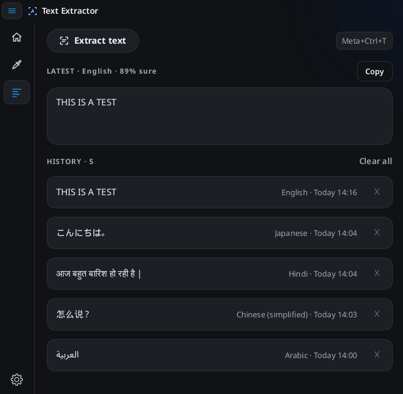 | 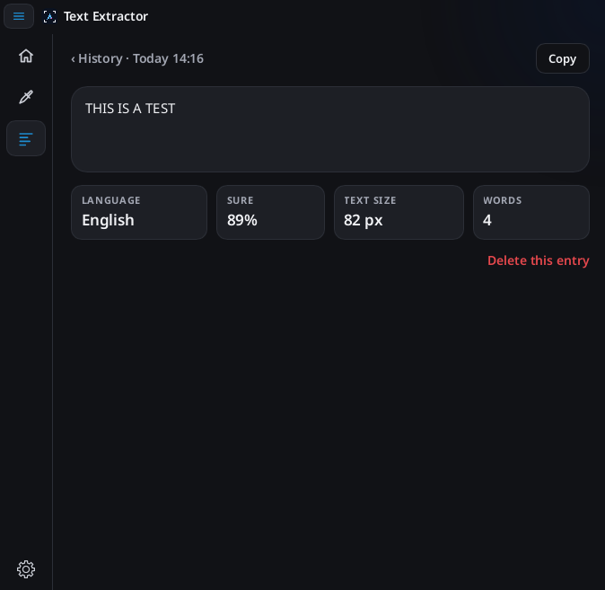 |

</div>

| To                                  | Do                                                                                                   |
| ----------------------------------- | ---------------------------------------------------------------------------------------------------- |
| Move the box while you drag         | Hold `Shift`                                                                                         |
| Nudge it one pixel                  | The arrow keys (it reads the text again)                                                            |
| Copy                                | `Enter`, or **Copy** on the toolbar. **Copy as one line** joins the lines.                          |
| Find which font it's in             | **Aa Find font** on the toolbar ([Font finder](#font-finder))                                       |
| Cancel                              | `Esc`                                                                                                |
| Copy without the toolbar            | **Settings → After selecting text → Copy and close**                                                 |
| Keep Archtoys out of the way        | **Settings → Stay minimized**                                                                        |
| See or reuse an older text          | Click it in the history (the last 500): its language, how sure Archtoys was, the text size and the words. Delete one or all. |
| Extract from a terminal             | `archtoys --extract` (starts Archtoys if it isn't running)                                          |

<details>
<summary>Which languages it reads</summary>

English, plus every language Tesseract has (except Hebrew). Archtoys reads with English and your own languages first (your system language, keyboard layouts and input methods), and when that isn't sure, with one language of every writing system side by side, and keeps the reading it is surest of. Those languages download once, the first time they're needed (about 32 MB), from Tesseract's own [language data](https://github.com/tesseract-ocr/tessdata_fast) on GitHub. Reading the text never needs the internet, and nothing you capture is sent anywhere. Offline, it reads with the languages it already has.

When a reading still isn't sure, Archtoys downloads that language's bigger, more accurate data once (from Tesseract's [best data](https://github.com/tesseract-ocr/tessdata_best)) and reads again. On a slow connection it doesn't wait: you get the quick reading, and the better data is used next time. Faint text (gray on gray, a dimmed label) is made dark on white before it's read, and Georgian, Amharic, Sinhala, Telugu, Kannada, Malayalam, Gujarati, Punjabi and Tibetan are read too. A short line is named by its letters and common words (é and _pour_ say French, ñ and _más_ Spanish), and when nothing gives it away, English.

Tested on 24 languages, from a word to a paragraph, 14 to 64 px, light and dark, bold, colored and compressed: 98% of the text comes back right. English, Spanish, French, German, Portuguese, Italian, Dutch, Turkish, Polish, Indonesian, Russian, Ukrainian, Greek, Arabic, Urdu, Hindi, Bengali, Tamil, Thai, Chinese (simplified and traditional), Japanese and Korean read 93-100% right, Vietnamese and Persian about 94%. Short phrases mixed with English, decorative fonts and very small or blurry text read worse, so check the text before you use it, and please [report](https://github.com/Mujtaba1i/Archtoys/issues) what it gets wrong.

</details>

### Font finder

Which font is that? Select the text with Text Extractor and press **Aa Find font**. Archtoys opens on a new history entry and compares your selection with fonts, word by word: it draws the words it read in each font that could match and keeps the ones that look most alike.

<div align="center">

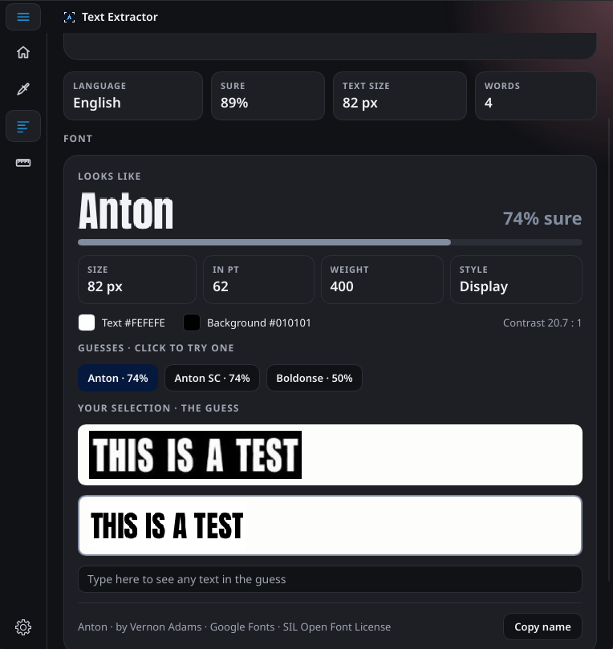

</div>

- **The fonts on your computer first, every time.** That's where most text on your screen comes from, and it needs no download.
- **Google Fonts too, if you turn it on.** The first time, Archtoys asks. Yes downloads a list of every Google Fonts family (about 10 MB, once), which picks a dozen that could match, and only those fonts are downloaded (usually 2 to 8 MB the first times, less after) from [Google Fonts on GitHub](https://github.com/google/fonts). Later searches reuse them. The list is updated monthly in [archtoys-font-index](https://github.com/Mujtaba1i/archtoys-font-index) and checked (SHA-256) before it's used.
- **Your selection never leaves your computer.** Only font files are downloaded, and the comparing happens on your computer.
- **The answer:** the font's name drawn in it and how sure Archtoys is, its size in px and pt, weight and style, the text and background colors with their contrast, up to three guesses to switch between, your selection above the guess, and a box to see any text in the guess. **Copy name** copies it, **Search again** reruns it (say, after turning on Google Fonts).
- **A font entry keeps a picture of your selection** in Archtoys' folder, so it can be searched again. Text-only entries keep none.
- **Settings → Font finder:** turn Google Fonts on or off, delete the downloaded fonts, or delete the saved pictures (the fonts found stay). **Settings → Reduce motion** shows the best guess while it searches instead of every font flashing past.

It's a best guess, not a sure answer, and Archtoys says so the first time. Your screen's scaling, its font smoothing and hinting, the text's size, bold or styled text and how much text you select all make it better or worse. Fonts made from the same design (Liberation Sans and Arimo, for example) look the same to it, so the right family is often among the guesses rather than first. Find font is grayed out when the text itself wasn't read surely enough, since it compares the words it read.

## Screen Ruler

Measure anything on screen, the way it looks: a button, the gap between two boxes, a line of text. Press `Ctrl+Super+M` (or **Measure**) and the screen freezes with a small toolbar at the top. The edges are where the color changes.

<div align="center">

|                                 Home                                 |                                Example                                 |
| :-------------------------------------------------------------------: | :-----------------------------------------------------------------: |
| 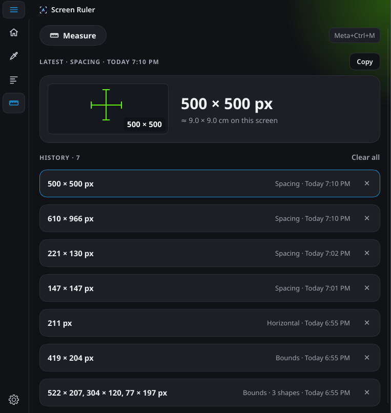 | 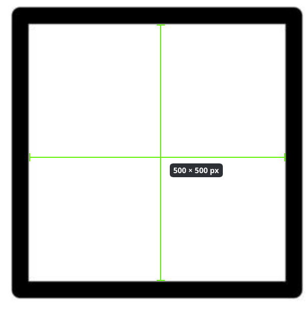 |


</div>

| Mode           | Measures                                                         | Key      |
| -------------- | ---------------------------------------------------------------- | -------- |
| **Bounds**     | A box you drag                                                   | `Ctrl+1` |
| **Spacing**    | From the cursor to the edges, across and up and down             | `Ctrl+2` |
| **Horizontal** | From the cursor to the edges, across only                        | `Ctrl+3` |
| **Vertical**   | From the cursor to the edges, up and down only                   | `Ctrl+4` |

| To                                  | Do                                                                                                   |
| ----------------------------------- | ---------------------------------------------------------------------------------------------------- |
| Copy the size                       | Click, or `Enter`. In Bounds, drag a box, then `Enter`, `Ctrl+C` or **Copy**.                        |
| Measure several boxes               | `Shift`-click keeps the box on the screen, then drag the next one. **Copy all** copies them all (3 at most). |
| Move one pixel                      | The arrow keys (ten pixels with `Shift`). In Bounds they move the box.                               |
| Change how much a color must differ to be an edge | The scroll wheel, or the − and + buttons (**Settings → Change the tolerance with**)    |
| Measure in cm or inches             | **Settings → Units**, when your screen reports its size (most monitors do, some projectors don't)   |
| Measure across screens              | A measure stops at the edge of the screen it's on, so it's never bigger than that screen. With more than one screen, **Settings → Across screens** lets it go on to the next one (never bigger than your screens added up). |
| Cancel                              | `Esc`                                                                                                |
| See older measurements              | The history on its page (sizes only, the last 500, never the screen). Delete one or all.             |
| Measure from a terminal             | `archtoys --measure` (starts Archtoys if it isn't running)                                          |

## Install

| Distribution             | How                                                                                                                                                                  |
| ------------------------ | -------------------------------------------------------------------------------------------------------------------------------------------------------------------- |
| **Fedora**               | `sudo dnf copr enable mujtaba1i/archtoys && sudo dnf install archtoys`                                                                                               |
| **Arch** and derivatives | `paru -S archtoys-bin` (prebuilt) or `paru -S archtoys` (from source). `yay` works too.                                                                              |
| **Debian, Ubuntu, Mint** | Download `archtoys_<version>_amd64.deb` from [Releases](https://github.com/Mujtaba1i/Archtoys/releases/latest), then `sudo apt install ./archtoys_*_amd64.deb`       |
| **Any distribution**     | Download `Archtoys-<version>-x86_64.AppImage` from [Releases](https://github.com/Mujtaba1i/Archtoys/releases/latest), then `chmod +x Archtoys-*.AppImage` and run it |

<details>
<summary>More about each package</summary>

- **Fedora, without COPR:** download the `.rpm` for your Fedora version from [Releases](https://github.com/Mujtaba1i/Archtoys/releases/latest) and run `sudo dnf install ./fedora-*-archtoys-*.rpm`.
- **.deb:** apt installs the dependencies for you. It works on Ubuntu 22.04 and newer, and Debian 12 and newer. There are no automatic updates yet, so download the new file for each version.
- **AppImage:** runs on any distribution from Ubuntu 22.04 onwards, or anything equally recent.
- **Text Extractor:** nothing extra to install. Open it and press **Turn on** (see [Text Extractor](#text-extractor)).
</details>

## Everywhere in Archtoys

| To                                  | Do                                                                                   |
| ----------------------------------- | ------------------------------------------------------------------------------------ |
| Switch toys, open Settings or About | The sidebar: click ☰ to keep it open, or rest the mouse on ☰                         |
| Change a hotkey, the theme, startup | **Settings**, at the bottom of the sidebar                                           |
| Move the window                     | Drag the bar at the top (handy when your desktop shows no title bar)                 |
| Report a problem                    | **Settings → Report a problem**                                                      |

## Desktop support

|                                        | KDE Plasma (Wayland) |               GNOME (Wayland)               | X11 (any desktop) |
| -------------------------------------- | :------------------: | :-----------------------------------------: | :---------------: |
| Picker with live preview and magnifier |   ✅ freeze frame    |               ✅ freeze frame               |      ✅ live      |
| Text Extractor                         |          ✅          |                     ✅                      |        ✅         |
| Screen Ruler                           |          ✅          |                     ✅                      |        ✅         |
| Several monitors                       |          ✅          |                     ✅³                     |        ✅         |
| Global hotkey                          |          ✅          | ✅ GNOME 48+ · ⚠️ older: `archtoys --pick`² |        ✅         |
| Tray icon                              |          ✅          |     ✅ with the AppIndicator extension¹     |        ✅         |

¹ Ubuntu enables it by default. On other GNOME setups, install _AppIndicator and KStatusNotifierItem Support_.<br>
² GNOME before 48 (including Ubuntu 22.04 and 24.04) can't register a global hotkey. Add your own in **Settings → Keyboard → Keyboard Shortcuts → Custom Shortcuts**, with the command `archtoys --pick`.<br>
³ If the desktop's screenshot doesn't line up with your monitors, Archtoys uses the desktop's own picker instead (same color, no magnifier). Please report it if that happens.

On GNOME before 48, add Text Extractor's and the Screen Ruler's shortcuts the same way, with `archtoys --extract` and `archtoys --measure`.

<details>
<summary>How picking works on Wayland</summary>

Wayland doesn't let apps watch the screen, which is good for your privacy. So when you start picking, Archtoys asks your desktop for **one screenshot** and shows it fullscreen while you choose. That's why moving content like videos pauses during a pick. The screenshot is deleted from disk as soon as it has been loaded, and nothing is ever saved.

Text Extractor and the Screen Ruler work the same way, on X11 too: one screenshot, deleted once loaded. They keep only the text they read or the sizes they measured (in their history), and nothing leaves your computer.

</details>

## Troubleshooting

<details>
<summary><b>Text Extractor can't be turned on</b></summary>

**Turn on** needs your password (your desktop asks for it in its own window) and your distribution's package manager. If you closed the password window, press **Turn on** again. On a distribution Archtoys doesn't know, or a read-only one, install the package `tesseract` (often `tesseract-ocr`) yourself and press **Check again**. Archtoys needs Tesseract 4.1 or newer.

</details>

<details>
<summary><b>My desktop asks for permission the first time</b></summary>

That's expected on Wayland. Archtoys asks your desktop for permission to take a screenshot (for picking) and to register a shortcut (for the hotkey). Allow both once.

</details>

<details>
<summary><b>The hotkey doesn't work on Wayland</b></summary>

On Wayland, the hotkey belongs to your desktop's shortcut system (the GlobalShortcuts portal): the first time, your desktop asks you to confirm it. After that, Archtoys' settings show the shortcut your desktop actually uses, with a **Change in System Settings** button (on KDE: **System Settings → Keyboard → Shortcuts → Archtoys**). Older desktops without that portal use a fallback that only works while an X11 app has focus.

To force the fallback, start Archtoys with:

```bash
ARCHTOYS_HOTKEY_BACKEND=x11 archtoys
```

</details>

<details>
<summary><b>No magnifier on Wayland with several monitors</b></summary>

The freeze frame shows one screenshot across all your monitors. If your desktop's screenshot doesn't line up with the monitors (an unusual layout or scaling), Archtoys falls back to the desktop's built-in color picker: it still picks the right color, but without the live preview. Run `archtoys` from a terminal to see why, and please **Report a problem** with that line.

</details>

<details>
<summary><b>Something else is wrong</b></summary>

Open **Settings** and click **Report a problem**. It opens a new GitHub issue with your version, distro, desktop and the picker and hotkey methods already filled in, so you only describe what's broken. Archtoys sends nothing itself, and no file paths, user names or colors are included.

Running `archtoys` from a terminal also prints which picker and hotkey method it's using, and why it fell back if it did.

</details>

## Building from source

<details>
<summary>Archtoys is written in Rust with the <a href="https://slint.dev">Slint</a> UI toolkit. Show the steps.</summary>

**1. Install the build tools for your distribution.**

```bash
# Fedora
sudo dnf install rust cargo gcc pkgconf-pkg-config fontconfig-devel freetype-devel libX11-devel libxkbcommon-devel

# Arch
sudo pacman -S --needed rust pkgconf fontconfig libx11 libxkbcommon

# Debian / Ubuntu
sudo apt install cargo pkg-config libfontconfig1-dev libx11-dev libxcb-shm0-dev libxkbcommon-dev
```

If your distribution's Rust is too old, install the latest with [rustup](https://rustup.rs).
For Text Extractor, install `tesseract` too (or turn it on in the app).

**2. Clone, test and run.**

```bash
git clone https://github.com/Mujtaba1i/Archtoys.git
cd Archtoys
cargo test --locked
cargo run --release --locked
```

On Wayland, the desktop knows an app by its `.desktop` file: without it there is no app icon (a generic "W" instead) and no global shortcut through the desktop. A package installs it. When you run from source with no package installed, add it for your user, pointing at your build:

```bash
mkdir -p ~/.local/share/applications ~/.local/share/icons/hicolor/256x256/apps
sed "s|^Exec=.*|Exec=$PWD/target/release/archtoys %u|" packaging/archtoys.desktop > ~/.local/share/applications/archtoys.desktop
cp packaging/archtoys-256.png ~/.local/share/icons/hicolor/256x256/apps/archtoys.png
```

Remove both files again before installing a package, or they take its place.

The window is drawn on the CPU (Slint's software renderer: it looks the same as OpenGL and uses about a third of the memory). To draw it with OpenGL instead, build with `cargo build --release --locked --no-default-features --features opengl`.

The color names and the search index are prebuilt into `data/names-index.*`. After changing `data/colornames.csv` (or how names are normalized), run `cargo test --locked write_name_index -- --ignored`. A test fails until you do.

The licence list in **About Archtoys** (`data/third-party-licenses.html`) is regenerated by every release with `cargo about generate about.hbs -o data/third-party-licenses.html`.

**Project layout**

```
src/
├── main.rs             startup and wiring
├── window.rs           the window's size, with or without the pinned sidebar
├── color.rs            color formats, parsing, shades (unit-tested)
├── formats.rs          which formats are shown, their order, Auto Copy
├── names.rs            color names (CSS names + the names list)
├── name_index.rs       the names and search index, prebuilt from data/colornames.csv
├── search.rs           color search: families, typos, codes (unit-tested)
├── editor.rs           the color editor and Compare
├── freeze.rs           the frozen screen the three toys share, one window per monitor
├── picker/             the Color Picker: X11 live picker, the freeze frame, fallbacks
├── ocr/                Text Extractor: Tesseract, installing it, languages, history
├── ruler/              the Screen Ruler: edges, sizes, the screen's real size, history
├── config.rs           settings (saved safely) and autostart
├── single_instance.rs  one copy at a time, archtoys --pick / --extract / --measure
├── diagnostics.rs      Report a problem
├── launch.rs           starting the browser and desktop settings
├── kwin.rs             KDE Plasma: hiding the window during a pick, keeping its place
├── ui_state.rs         updating the main window
├── tray.rs             tray icon
├── portal.rs           talking to the desktop portal
└── hotkey/             global hotkeys (portal and X11)
ui/app.slint            the main window
ui/shell.slint          the menu bar, sidebar, Home
ui/picker.slint         the Color Picker's page
ui/text.slint           Text Extractor's page
ui/ruler.slint          the Screen Ruler's page and its toolbar
ui/settings.slint       Settings and About
ui/freeze.slint         the frozen screen's windows
ui/common.slint         theme and shared widgets
```

</details>

## Roadmap

Archtoys is growing into a **PowerToys-style toolkit for Linux**, one tool at a time.

- [x] Color search
- [x] A new look: the color card, shades with names, themes, and a new logo
- [x] A color editor, and comparing two colors (contrast ratio)
- [x] **Text Extractor**: select any area of the screen and copy the text in it (OCR)
- [x] Buy me a coffee button
- [x] **Screen Ruler**: measure things on screen
- [x] **Font finder** in Text Extractor: which font a text is in, and its size (v0.7.5)
- [ ] **Awake**: keep your PC from sleeping for as long as you choose

Which PowerToys feature do you miss most on Linux? [Open an issue](https://github.com/Mujtaba1i/Archtoys/issues) and say so.

## Support Archtoys

Archtoys is free and always will be. If it saves you time, you can [buy me a coffee](https://mujtaba1i.github.io/Archtoys/support/) on Ko-fi: a one-time tip, no account needed. Tips are optional and don't buy features or support, they just help keep Archtoys going. Supporters who choose to show their name are thanked in [SUPPORTERS.md](SUPPORTERS.md). Thank you!

## Contributing

Bug reports, ideas and pull requests are all welcome. [CONTRIBUTING.md](CONTRIBUTING.md) explains how to build, test and send a change, and everyone taking part follows the [Code of Conduct](CODE_OF_CONDUCT.md).

## Acknowledgements and license

Inspired by [Microsoft PowerToys](https://github.com/microsoft/PowerToys). The Screen Ruler is inspired by the ruler in [PixelKit](https://github.com/Kuucheen/PixelKit) by Kuucheen (MIT). Archtoys is an independent project and is not affiliated with or endorsed by Microsoft. Color names come from [meodai/color-names](https://github.com/meodai/color-names) by David Aerne, used under the MIT License (see [`data/colornames-LICENSE.txt`](data/colornames-LICENSE.txt)).

Text Extractor uses [Tesseract OCR](https://github.com/tesseract-ocr/tesseract) and its [language data](https://github.com/tesseract-ocr/tessdata_fast) (Apache-2.0), installed and downloaded on your computer, not built into Archtoys, and [whatlang](https://github.com/greyblake/whatlang-rs) (MIT) to tell languages apart. The interface is made with [Slint](https://slint.dev), under its royalty-free licence. Every other library and its licence is listed in **Settings → About Archtoys → Open-source licences**.

[MIT](LICENSE) © 2026 Mujtaba1i
