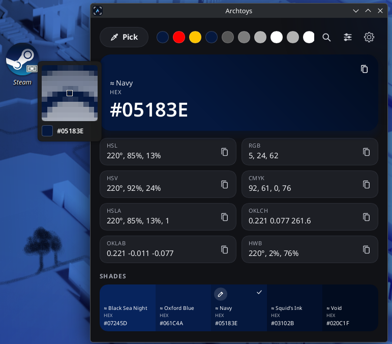
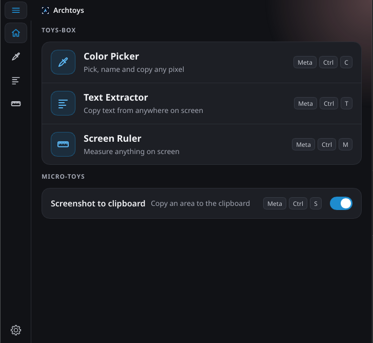
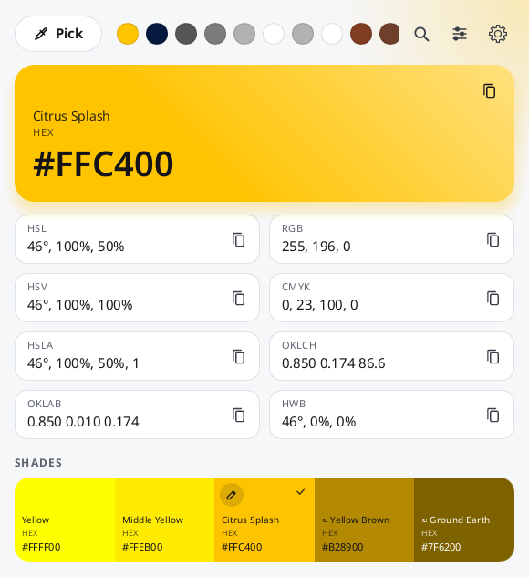
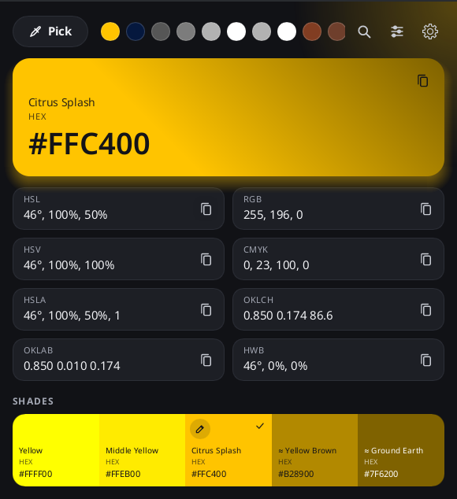
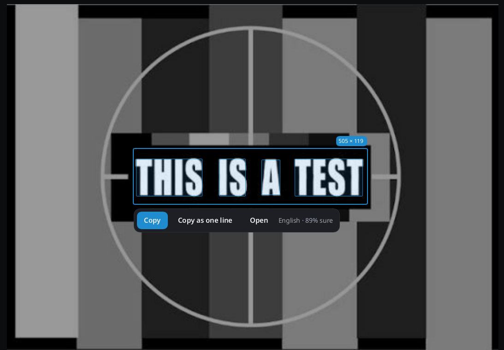
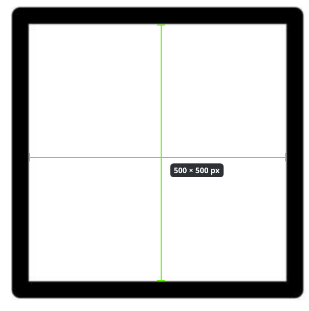

# Archtoys

**PowerToys-style tools for Linux, inspired by Microsoft PowerToys.**

**Color Picker** | **Text Extractor** | **Screen Ruler** | **Micro-toys** 
Wayland and X11 | at home on KDE Plasma | works offline

**[Install](#install)** | **[Wiki](https://github.com/Mujtaba1i/Archtoys/wiki)** | **[What's new](https://github.com/Mujtaba1i/Archtoys/releases/latest)**

## The toys

Each toy has its own hotkey and works from anywhere. Archtoys lives in the tray, starts on login if you like, and updates itself.

| Toy | What it does | Hotkey |
| --- | --- | --- |
| [**Color Picker**](https://github.com/Mujtaba1i/Archtoys/wiki/Color-Picker) | Pick any pixel, see it magnified and named, find colors by name, copy them in the format you need | `Ctrl+Super+C` |
| [**Text Extractor**](https://github.com/Mujtaba1i/Archtoys/wiki/Text-Extractor) | Copy the text in any part of the screen, even from images and videos, and find which font it's in | `Ctrl+Super+T` |
| [**Screen Ruler**](https://github.com/Mujtaba1i/Archtoys/wiki/Screen-Ruler) | Measure anything on screen: a box, the space around a point, a width or a height | `Ctrl+Super+M` |

| Micro-toy | What it does | Hotkey |
| --- | --- | --- |
| **Screenshot to clipboard** | Drag over an area of the screen and it's copied as a picture, never saved | `Ctrl+Super+S` |

### Color Picker

A 10x magnifier next to your cursor, on every monitor, and on Wayland too. Every color gets its name (the CSS name, or the closest of ~32,000), its shades and a place in your history, in the formats you choose: HEX, RGB, HSL, HSV, CMYK, OKLCH, OKLab and more. Press `Ctrl+F` to find colors by name, word or code (_sky_, _dark red_, `#FF46A2`), and open the editor to fine-tune one or compare two by their contrast.

|                                 Light                                 |                                Dark                                 |
| :-------------------------------------------------------------------: | :-----------------------------------------------------------------: |
|  |  |

### Text Extractor

Drag over any text on screen and copy it: a picture, a video, a PDF, an app that won't let you select its text. Archtoys finds the language by itself (24 languages tested, 98% of the text right) and nothing you capture leaves your computer. **Find font** tells you which font the text is in, and its size.

### Screen Ruler

Freeze the screen and measure a button, the gap between two boxes, or a line of text, in pixels, centimeters or inches. The edges are found where the color changes.

## Install

| Distribution             | How                                                                                                                                                                  |
| ------------------------ | -------------------------------------------------------------------------------------------------------------------------------------------------------------------- |
| **Fedora**               | `sudo dnf copr enable mujtaba1i/archtoys && sudo dnf install archtoys`                                                                                               |
| **Arch** and derivatives | `paru -S archtoys-bin` (prebuilt) or `paru -S archtoys` (from source). `yay` works too.                                                                              |
| **Debian, Ubuntu, Mint** | Download `archtoys_<version>_amd64.deb` from [Releases](https://github.com/Mujtaba1i/Archtoys/releases/latest), then `sudo apt install ./archtoys_*_amd64.deb`       |
| **Any distribution**     | Download `Archtoys-<version>-x86_64.AppImage` from [Releases](https://github.com/Mujtaba1i/Archtoys/releases/latest), then `chmod +x Archtoys-*.AppImage` and run it |

More about each package, and how updates work, in the wiki: [Install](https://github.com/Mujtaba1i/Archtoys/wiki/Install) and [Updates](https://github.com/Mujtaba1i/Archtoys/wiki/Updates).

## Works on

KDE Plasma and GNOME on Wayland, and any desktop on X11. Every change is tested on X11, KDE Plasma 5 and KDE Plasma 6. On older GNOME versions a few things need a step of your own: see [Desktop support](https://github.com/Mujtaba1i/Archtoys/wiki/Desktop-Support).

## Learn more

The **[wiki](https://github.com/Mujtaba1i/Archtoys/wiki)** has everything else:

- every toy in detail: [Color Picker](https://github.com/Mujtaba1i/Archtoys/wiki/Color-Picker), [Text Extractor](https://github.com/Mujtaba1i/Archtoys/wiki/Text-Extractor), [Screen Ruler](https://github.com/Mujtaba1i/Archtoys/wiki/Screen-Ruler), [Micro-toys](https://github.com/Mujtaba1i/Archtoys/wiki/Micro-toys)
- [Using Archtoys](https://github.com/Mujtaba1i/Archtoys/wiki/Using-Archtoys): the sidebar, Settings and the terminal commands
- [Troubleshooting](https://github.com/Mujtaba1i/Archtoys/wiki/Troubleshooting) and [Building from source](https://github.com/Mujtaba1i/Archtoys/wiki/Building-from-Source)

## Roadmap

Archtoys is growing into a **PowerToys-style toolkit for Linux**, one tool at a time.

- [x] Color search
- [x] A new look: the color card, shades with names, themes, and a new logo
- [x] A color editor, and comparing two colors (contrast ratio)
- [x] **Text Extractor**: select any area of the screen and copy the text in it (OCR)
- [x] Buy me a coffee button
- [x] **Screen Ruler**: measure things on screen
- [x] **Font finder** in Text Extractor: which font a text is in, and its size
- [x] **Micro-toys**: small hotkey helpers, starting with Screenshot to clipboard 
- [ ] **Awake**: keep your PC from sleeping for as long as you choose

Which PowerToys feature do you miss most on Linux? [Open an issue](https://github.com/Mujtaba1i/Archtoys/issues) and say so.

## Support Archtoys

Archtoys is free forever. If you find it useful, you can leave an optional, one-time tip on [Ko-fi](https://mujtaba1i.github.io/Archtoys/support/) Named supporters are thanked in [SUPPORTERS.md](SUPPORTERS.md).

## Contributing

Bug reports, ideas, and PRs are welcome, see [CONTRIBUTING.md](CONTRIBUTING.md) and our [Code of Conduct](CODE_OF_CONDUCT.md). Report bugs easily via **Settings -> Report a problem**.

## Acknowledgements and license

* **Inspiration:** [Microsoft PowerToys](https://github.com/microsoft/PowerToys) (independent project; unaffiliated with Microsoft) and [PixelKit](https://github.com/Kuucheen/PixelKit) (MIT).
* **Libraries & Data:** [color-names](https://github.com/meodai/color-names) ([MIT](data/colornames-LICENSE.txt)), local [Tesseract OCR](https://github.com/tesseract-ocr/tesseract) & [tessdata_fast](https://github.com/tesseract-ocr/tessdata_fast) (Apache-2.0), [whatlang](https://github.com/greyblake/whatlang-rs) (MIT), and [Slint](https://slint.dev). Full license list in **Settings → About Archtoys → Open-source licences**.

[MIT](LICENSE) © 2026 Mujtaba1i
